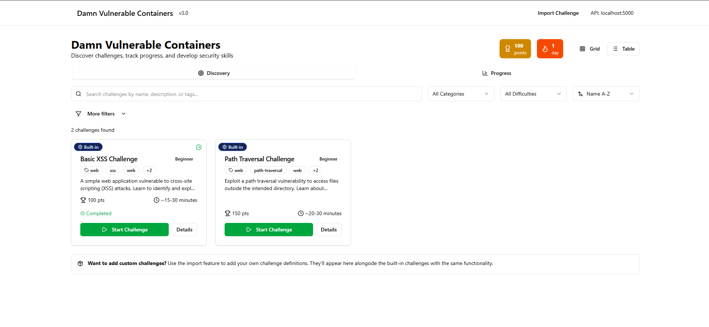
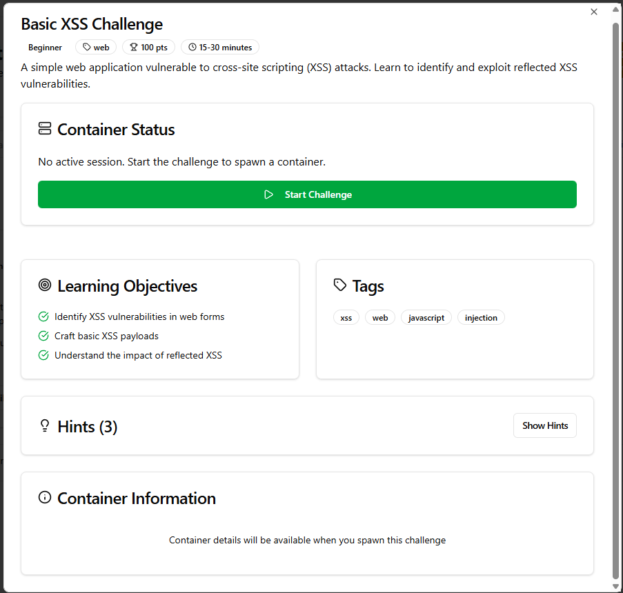

# Damn Vulnerable Containers (DVC)

[](https://github.com/markmysler/dvc/actions/workflows/ci.yml)
[](LICENSE)

A self-hosted platform for practising offensive security against intentionally vulnerable apps. Each challenge runs in its own locked-down Docker container. You start it from a web UI, exploit it, and submit the flag. Everything runs on your machine, with no accounts or cloud services.



> **Status:** the platform (orchestration, isolation, flags, hints, import) is complete. The catalogue currently ships **one** challenge (path traversal); more can be added through the import wizard or the [challenge development guide](CHALLENGE_DEVELOPMENT.md).

## Quick start

Requires Docker with the Compose plugin, and `bash` with `openssl` or `python3`.

```bash
git clone https://github.com/markmysler/dvc.git
cd dvc
./start.sh            # API + frontend
./start.sh --monitor  # also Prometheus, Grafana, cAdvisor, node-exporter
```

`start.sh` checks dependencies, generates a random `FLAG_SECRET_KEY` in `.env`, starts the containers and waits until they are healthy. Challenge images are built the first time each challenge is started, so expect a short wait then.

| Service | URL |
|---|---|
| Challenge browser | http://localhost:3001 |
| API | http://localhost:5000/api |
| Grafana (`--monitor`) | http://localhost:3000 |
| Prometheus (`--monitor`) | http://localhost:9090 |

Stop everything with `docker compose down`.

## Using it

1. Open the challenge browser and pick a challenge.
2. **Start challenge** launches your own instance and shows its URL (a random port on `127.0.0.1`).
3. Exploit it. Hints unlock over time if you get stuck.
4. Submit the flag (`flag{16 hex chars}`). Progress is kept in your browser's localStorage.
5. A solved instance shuts down after 30 seconds; unsolved ones stop when their session expires (60 minutes by default).



## Architecture

```
Browser ──► Frontend (Next.js, :3001)
   │
   └──────► API (Flask + gunicorn, :5000) ──► Docker Engine (via socket)
              ├─ orchestrator: build image, start challenge + port proxy
              ├─ session manager: in-memory sessions, expiry, limits
              ├─ flag system: HMAC-SHA256 per instance
              └─ hint service: time-based progressive hints

Per challenge session:
   internal network "dvc-net-<session>"  (no route out)
     ├─ challenge container   (read-only, no capabilities, uid 1000)
     └─ socat port proxy ───► published on 127.0.0.1:<random port>
```

### Challenge lifecycle

1. `POST /api/challenges` with `challenge_id` and `user_id`. The per-user limit (5 running challenges) is checked first.
2. The orchestrator builds the image from `build_context` if it doesn't exist yet.
3. A unique flag is generated: `HMAC-SHA256(FLAG_SECRET_KEY, "challenge:user:timestamp,nonce")`, truncated to 16 hex characters. It is passed to the container as `CHALLENGE_FLAG`.
4. The challenge starts alone on a new **internal** Docker network, and a small socat proxy publishes its port on `127.0.0.1`.
5. `POST /api/flags` recomputes the HMAC and compares it in constant time.
6. Ending the session (solve, timeout or `DELETE`) removes the challenge, its proxy and its network. A reaper also removes expired containers left over from an API restart.

### API

| Method | Path | Purpose |
|---|---|---|
| GET | `/api/health` | Health and session stats |
| GET | `/api/challenges` | Challenge catalogue |
| POST | `/api/challenges` | Start a challenge (`challenge_id`, `user_id`, optional `session_timeout` 60–7200 s) |
| GET | `/api/challenges/running` | Running challenges |
| DELETE | `/api/challenges/<session_id>` | Stop a challenge |
| POST | `/api/flags` | Submit a flag (`flag`, `session_id`) |
| POST | `/api/flags/batch` | Submit several flags |
| GET | `/api/hints?challenge_id=&session_id=` | Hints unlocked so far in a running session |
| POST | `/api/hints` | Unlock the next hint early (`challenge_id`, `session_id`, `action: "request"`) |
| GET | `/api/hints/status?challenge_id=&session_id=` | Hint progress and time to the next unlock |
| POST | `/api/import/` | Import a challenge (JSON or ZIP, needs `X-DVC-Request: 1`) |
| DELETE | `/api/import/<challenge_id>` | Remove an imported challenge |

## Security model and known limitations

DVC deliberately runs vulnerable code, so the platform's job is to keep that code contained. What it does:

- **Challenge containers:** all capabilities dropped, `no-new-privileges`, Docker's default seccomp profile, uid 1000, a read-only root filesystem with small `noexec` tmpfs mounts, memory/CPU/PID limits, and no IPC namespace sharing ([`security/container-profiles.json`](security/container-profiles.json)).
- **Network:** each challenge sits alone on an `internal` network. It cannot reach the internet, the Docker host, the platform API or other players' challenges. Players reach it only through the proxy.
- **Local only by default:** every port, including challenge ports, is bound to `127.0.0.1`.
- **Flags:** HMAC-SHA256 with a random per-install key. The platform refuses to start without a key or with a placeholder one.
- **Import:** requires a custom header (CSRF protection), limits upload and extracted size, rejects unsafe ZIP paths, caps resource limits, always applies the hardened profile, and never trusts a user-supplied build path.

Known limitations, by design for a single-user local lab:

- **The API has no authentication** and controls the Docker socket, which is root-equivalent on the host. Keep it on `127.0.0.1`. If you set `DVC_BIND_ADDRESS` to expose it, only do so on an isolated lab network.
- **Users are not authenticated.** The frontend uses one local user, and progress lives in localStorage.
- **The flag is visible to code inside its own container** (it is in the environment). A player with code execution can read it, which still requires exploiting the challenge.
- **Sessions are in memory.** Restarting the API forgets them; the reaper then stops their containers when they expire.

## Configuration

Set these in `.env` (created by `start.sh`) or your shell:

| Variable | Default | Purpose |
|---|---|---|
| `FLAG_SECRET_KEY` | generated | HMAC key for flags (required, 32+ characters) |
| `DVC_BIND_ADDRESS` | `127.0.0.1` | Interface for all published ports, including challenges |
| `HOST` | `localhost` | Hostname shown in challenge URLs and allowed by CORS |

## Development

### Adding a challenge

The easiest way is the **Import** page in the UI (JSON definition, or a ZIP with a `Dockerfile` and `config.json`). To add one to the repository instead, follow [CHALLENGE_DEVELOPMENT.md](CHALLENGE_DEVELOPMENT.md). In short:

1. Create `challenges/<name>/` with a `Dockerfile` and the app. Read the flag from `CHALLENGE_FLAG`; write runtime files under `/app/runtime` (the rest of the filesystem is read-only).
2. Add the definition to [`challenges/definitions/challenges.json`](challenges/definitions/challenges.json) with `build_context` pointing at the folder.
3. Check it with `python scripts/validate-challenge.py challenges/definitions/challenges.json`.

### Tests

```bash
pip install -r api/requirements.txt pytest
FLAG_SECRET_KEY=$(openssl rand -hex 32) pytest
cd frontend && npm ci && npm run lint && npx tsc --noEmit
```

CI runs the same checks on every push and pull request.

### Running without Compose

```bash
export FLAG_SECRET_KEY=$(openssl rand -hex 32)
(cd api && python app.py)            # API on 127.0.0.1:5000 (FLASK_DEBUG=1 for the debugger)
(cd frontend && npm install && npm run dev)
```

### Troubleshooting

- **`FLAG_SECRET_KEY is not set`**: run `./start.sh`, or add a key to `.env`.
- **A challenge won't start**: `docker compose logs api` shows image build errors.
- **The UI can't reach the API**: check `docker compose ps` and that `HOST` matches the hostname in your browser.

## Project structure

```
api/          Flask app: routes for challenges, flags, hints, import
engine/       Orchestrator, session manager, flag system, hint service, port proxy image
challenges/   Challenge definitions and challenge sources
frontend/     Next.js UI
security/     Container security profiles
monitoring/   Prometheus and Grafana configuration
scripts/      Validation and maintenance scripts
tests/        Python tests
```

## License

[MIT](LICENSE). The challenges are intentionally vulnerable; only run them on a machine you control.
